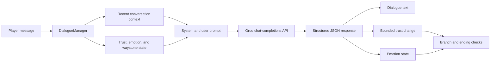

# The Warden of the Ashwood

A Unity 6 URP prototype that connects in-world NPC dialogue to an LLM-driven trust, emotion, and quest-state system.

Players speak with Eolindra, an ancient forest guardian. Each response is generated in character and returned as structured JSON containing dialogue, a bounded trust change, an emotion label, and a short internal reason. Local game logic then updates the conversation state and selects the next branch.

> **Repository status:** use the newer `ai-powered-npc-game---v2_Nisarg` implementation as the code source of truth, then migrate the repaired project into the cleaner `ai-powered-npc-game` repository. The current public scene/build configuration needs repair before a reproducible demo is claimed.

## Implemented systems

- Groq chat-completions integration using a configurable model
- Structured JSON response parsing with a local fallback response
- Short in-session conversation context limited to the latest eight lines
- Trust score bounded from 0 to 100
- Eight emotion states: hostile, angry, suspicious, sad, neutral, curious, warm, and grateful
- Trust momentum and consecutive-negative interaction tracking
- Attack/game-over path after repeated hostile interactions
- Three-waystone quest-state context and trust rewards
- First-person interaction, dialogue UI, NPC patrol/face-player behavior, a world-space emotion bubble, and ending UI

This is an LLM-assisted dialogue prototype. It does not implement an autonomous agent or durable cross-session memory.

## Architecture



## Technology

- Unity `6000.0.70f1`
- Universal Render Pipeline `17.0.4`
- C#
- Unity Input System
- Unity AI Navigation
- TextMesh Pro and Unity UI
- Groq-compatible chat-completions request flow
- Default model configured in code: `llama-3.3-70b-versatile`

## Project layout

The actual Unity project is currently nested under:

```text
AI Powered NPC Game/
  Assets/
    Scenes/MainScene.unity
    Scripts/NPC/
    Scripts/Player/
    Scripts/UI/
  Packages/
  ProjectSettings/
```

The duplicate root-level `Packages/` and `ProjectSettings/` directories should be removed after the nested project is verified.

## Local setup

1. Install Unity `6000.0.70f1` through Unity Hub.
2. Open the nested `AI Powered NPC Game/` directory as the Unity project.
3. Add `Assets/Scenes/MainScene.unity` to Build Settings after verifying the scene opens without missing scripts.
4. Create a local `APIConfig` ScriptableObject through **Create → NPC → API Config**.
5. Supply your own local development key and ensure the generated credential asset remains ignored by Git.
6. Verify the Inspector references described in the known-issues section before entering Play mode.

Never commit an API key. A key stored in a Unity client or downloadable build can be extracted. Use a protected backend proxy before distributing a build.

## Known issues to resolve before publishing a demo

- Revoke the previously exposed Groq key and purge the removed credential asset from Git/LFS history.
- Add `MainScene` to the active build settings; the current nested build settings reference a missing sample scene.
- Repair the missing-script reference associated with `FloatingEmotionIcon`; the separate `EmotionBubbleController` is the currently wired emotion visual.
- Wire `DialogueManager.emotionIcon`, `gameOverCanvas`, and the three waystone prompt objects in the scene.
- Align the serialized starting emotion with the code default.
- Decide whether the positive ending should require both trust of at least 80 and all three waystones; the current code checks only trust.
- Remove duplicate root project settings and validate the intended project root.
- Add a custom screenshot or short capture only after the scene runs cleanly.

## Safety, privacy, and licensing notes

- LLM output is probabilistic and the current prototype does not include a full moderation or abuse-handling layer.
- Conversation context is held in memory for the current session only; there is no persistent player profile.
- The fallback keeps the interaction moving when the API fails, but it is not an offline dialogue system.
- The repository contains third-party asset packages. Confirm redistribution rights and add explicit credits before publishing a release or downloadable build.
- The emotion-icon art provenance should be verified.
- No automated Unity tests, continuous integration, release build, or downloadable demo is currently provided.
